# Issue 866 ownership feasibility

This implementation record accompanies the [approved testing-hook plan](issue-866-pre-activation-testing-hooks.md) and [pinned Skoolit inventory](issue-866-skoolit-scenario-inventory.md). The proof uses .NET SDK 10.0.102, Hosting 10.0.8 and Aspire 13.4.4. All graphs and values are synthetic; no application resources were started by profile activation.

## Observed failure of late capture

The first executable used the real [AppSurface startup](../../ForgeTrust.AppSurface.Core/AppSurfaceStartup.cs) and public host callbacks. It established configuration-hook ordering before services/profile construction and preserved default DI versus later Autofac container precedence. It also disproved late root-only ownership capture:

| Failure boundary | Observation |
| --- | --- |
| Later configuration-source Build throws | An earlier provider was acquired but remained undisposed; no application root existed to capture. |
| Module replaces ContentRootFileProvider | The appended callback saw the replacement and could not identify Hosting's original PhysicalFileProvider. |
| IHost resolution throws after the selected factory returns | A raw provider existed but no returned host or public host context exposed it for cleanup. |

These were negative controls, not passing ownership checks. Hosting's [build pipeline](https://github.com/dotnet/runtime/blob/v10.0.8/src/libraries/Microsoft.Extensions.Hosting/src/HostBuilder.cs) constructs configuration and providers before returning an IHost; its application root normally owns the chained host configuration. Flat reference deduplication cannot represent that ownership tree.

## Revised internal mechanism

The internal [StartupContext factory seam](../../ForgeTrust.AppSurface.Core/StartupContext.cs) installs an [observing IHostBuilder](../../Aspire/ForgeTrust.AppSurface.Aspire/AspireProfileActivationHostBuilder.cs) before defaults and module callbacks. Defaults still come from ConfigureDefaults; selected provider and container types are retained. The first application callback captures the host configuration and original content-root provider. Source wrappers are installed after configuration callbacks, so normal callbacks inspect the original sources. Each provider returned to framework construction and each reload registration receives an identity-aware, idempotent lease.

The revised scratch executable completed 17 cases with exit 0. It observed provider cleanup once after source-Build failure, both returned providers once after root-Load failure, zero remaining reload registrations, detached-root cleanup, replaced file-provider cleanup and raw provider cleanup after host-resolution failure. The late-capture negative controls still report their three failures, demonstrating that the positive result comes from the earlier mechanism.

The first committed-shape integration fixture passed 12 of 13 cases and exposed an additional real Hosting behavior: a DI-owned IHost can re-enter host disposal, causing an otherwise non-idempotent custom provider/file provider to receive disposal twice. The fix decorates the selected singleton IHost factory with a host lease. Its Services remains the exact selected raw provider. A per-instance disposal-flow marker makes recursive container-driven disposal return immediately while independent callers join the same cleanup task. The revised durable integration fixture passed all 17 cases with exit 0, including the real Autofac module, Development validation, exactly-once selected provider/file cleanup, host cleanup failure and explicit lifecycle forwarding. Public API implementation proceeds only after this passing ownership gate.

## Ownership boundaries and limits

Configuration roots built explicitly inside user callbacks belong to the caller. A custom configuration source owns allocations it fails to return; a custom service-provider factory owns allocations it fails to return as its provider. Removed sources and singleton instances are never disposed merely because a callback supplied them. Borrowed chained configuration retains ShouldDisposeConfiguration=false; explicit ownership-transfer chaining retains its framework policy. Module-created file providers discarded before framework acquisition remain the module's responsibility.

Once Build returns, file-provider and service-provider cleanup follows the returned host. Detached and partially constructed configuration trees remain with the activation ownership scope. Secondary disposal errors do not replace a primary factory error; captured configuration leases are still drained after such errors. These boundaries follow actual [configuration-root construction and disposal](https://github.com/dotnet/runtime/blob/v10.0.8/src/libraries/Microsoft.Extensions.Configuration/src/ConfigurationRoot.cs) and [host disposal](https://github.com/dotnet/runtime/blob/v10.0.8/src/libraries/Microsoft.Extensions.Hosting/src/Internal/Host.cs), rather than private reflection or diagnostic interception.

## Configured factory ownership

The [testing wrapper lifecycle](../../Aspire/ForgeTrust.AppSurface.Aspire.Testing/README.md#builder-lifecycle) includes the factory-only `Preparing` state. Its guard forwards graph customization through the same wrapper used for composition. A successful factory call transfers that wrapper to the caller without building or starting the Aspire application.

```mermaid
flowchart TD
    F[Configured factory during Preparing] --> A[Activation lease]
    A --> H[Observed activation host and selected raw provider]
    A --> L[Identity leases for acquired configuration providers, reload registrations and file providers]
    F --> W[Guarded Aspire testing wrapper]
    W --> U[Unbuilt Aspire configuration and acquired file providers]
    F -->|composition completes| C[Caller receives Active wrapper]
    C --> W
    W -->|BuildAsync transfers graph ownership| P[Built Aspire application]
    P --> R[Aspire provider and application resources]
    W -->|fallback application disposal| P
    W -->|activation cleanup after Aspire cleanup| A
```



The two service providers stay separate: activation services construct the AppSurface profile and components; Aspire services belong to the application graph. Before a successful Aspire build, the wrapper retains ownership of its acquired unbuilt graph objects. On factory abort, it cleans that graph before the activation lease. After a successful build, the application owns the Aspire graph, and wrapper disposal provides an application-first fallback before releasing activation services.

Inside the activation lease, the observing host builder captures acquisitions before host construction can fail. Returned hosts perform their normal provider and file-provider cleanup; idempotent leases also drain partially constructed or detached configuration trees without repeating cleanup. A synchronous configuration-root disposal leaves an async-only provider for the activation owner to await. Recursive cleanup returns immediately within its own disposal flow, while independent callers join the same completion. Caller-owned roots and objects remain subject to the [ownership boundaries above](#ownership-boundaries-and-limits).

## Reproducible integration

The durable [ownership regression fixture](../../Aspire/ForgeTrust.AppSurface.Aspire.Tests/AspireProfileActivationHostBuilderTests.cs) covers partial source/root failures, nested/shared/detached configuration, caller-owned objects, replaced providers, constructor-visible order, Development validation, actual Autofac-module precedence, returned-host cleanup errors and explicit lifecycle forwarding. Run it with:

```sh
dotnet test Aspire/ForgeTrust.AppSurface.Aspire.Tests/ForgeTrust.AppSurface.Aspire.Tests.csproj -c Release --filter FullyQualifiedName~AspireProfileActivationHostBuilderTests
```

The scratch executable initially stalled with native file watching. Its bounded rerun enabled only DOTNET_USE_POLLING_FILE_WATCHER=1 in the child process, matching the repository's existing [Aspire test runtime initialization](../../Aspire/ForgeTrust.AppSurface.Aspire.Tests/AssemblyInfo.cs). This runtime setting is separate from the four per-call scenario selectors. The standalone scratch carrier resolved MessagePack 2.5.192 and emitted NuGet audit warnings; the repository centrally pins MessagePack 2.5.301. No production dependency version was changed by the spike.
